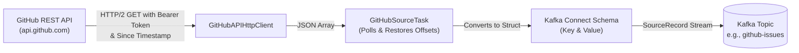

# Kafka GitHub Source Connector

[](https://www.oracle.com/java/)
[](https://kafka.apache.org/)
[](LICENSE)

A robust, production-ready **Kafka Connect Source Connector** that streams issues and pull requests from any public or private GitHub repository directly into Apache Kafka topics in near-real-time.

---

## Table of Contents

- [Overview](#overview)
- [Key Features](#key-features)
- [Architecture & Workflow](#architecture--workflow)
- [Prerequisites](#prerequisites)
- [Build & Package](#build--package)
- [Configuration Reference](#configuration-reference)
- [Quickstart & Running](#quickstart--running)
  - [Distributed Mode (REST API)](#distributed-mode-rest-api)
  - [Standalone Mode](#standalone-mode)
- [Data Model & Schema](#data-model--schema)
  - [Record Key Schema](#record-key-schema)
  - [Record Value Schema](#record-value-schema)
- [Rate Limiting & Authentication](#rate-limiting--authentication)
- [Development & Testing](#development--testing)

---

## Overview

`kafka-github-source-connector` connects to GitHub's REST API (`https://api.github.com/repos/{owner}/{repo}/issues`) to ingest repository issues and pull requests into Kafka. It guarantees incremental state synchronization using Kafka Connect's native offset storage framework.

---

## Key Features

- **Incremental Polling & Fault-Tolerant Offsets:** Tracks repository name, issue update timestamp (`updated_at`), issue number, and pagination offset. Restarts pick up exactly where ingestion paused without duplicating data.
- **Smart Rate-Limit Handling:** Monitors GitHub's rate limit headers (`X-RateLimit-Limit`, `X-RateLimit-Remaining`, and `X-RateLimit-Reset`). Dynamically sleeps to throttle calls and automatically pauses until quota reset when limits (e.g. HTTP 403 / 429) are approached.
- **Secure Token Storage:** Supports Personal Access Tokens (PAT) via Kafka Connect's masked `PASSWORD` type (`bearer.github.pat.token`), preventing credentials from leaking into server logs or REST APIs.
- **Rich Typed Schemas:** Emits structured records with typed keys and values using Kafka Connect schemas, including nested user attribution and pull request links.
- **Flexible Cutoff Filtering:** Custom `since.timestamp` configuration allows backfilling from a specific date or defaulting to issues updated within the past year.
- **Java 17 & HTTP/2 Standard Client:** Built on standard JDK `HttpClient` with HTTP/2 support, zero external HTTP dependencies, and Jackson for JSON parsing.

---

## Architecture & Workflow



1. **Connector Start:** Validates configuration (`GitHubSourceConnectorConfig`).
2. **Task Execution:** `GitHubSourceTask` initializes and checks Connect's offset reader for previous positions (`updated_at`, issue number, next page).
3. **HTTP Fetch:** Issues request to GitHub's `/repos/{owner}/{repo}/issues` ordered chronologically.
4. **Schema Transformation:** Converts raw GitHub JSON records into strongly typed `SourceRecord` instances.
5. **Topic Publish:** Publishes records to Kafka with partition offsets updated per record.

---

## Prerequisites

- **Java Development Kit (JDK):** Version 17 or later
- **Apache Maven:** Version 3.8+
- **Apache Kafka / Kafka Connect:** Version 3.0+ (Tested against Kafka 3.9.0)
- **GitHub Account & PAT (Optional):** Highly recommended. Unauthenticated requests are limited to 60 requests/hour, while PAT authentication increases quota to 5,000 requests/hour.

---

## Build & Package

To build the connector and package the shaded fat-JAR:

```bash
mvn clean package
```

The build produces two artifacts in the `target/` directory:
- `kafka-github-source-connector-1.0-SNAPSHOT.jar` (thin JAR)
- `kafka-github-source-connector-1.0-SNAPSHOT-jar-with-dependencies.jar` (**fat JAR** containing all runtime dependencies)

To install into Kafka Connect, copy the **fat JAR** into a folder located in Kafka Connect's `plugin.path`:

```bash
mkdir -p /opt/connect-plugins/kafka-github-source-connector
cp target/kafka-github-source-connector-1.0-SNAPSHOT-jar-with-dependencies.jar /opt/connect-plugins/kafka-github-source-connector/
```

Ensure your `connect-distributed.properties` or `connect-standalone.properties` includes:
```properties
plugin.path=/opt/connect-plugins
```

---

## Configuration Reference

| Parameter | Type | Importance | Default | Description |
| :--- | :--- | :--- | :--- | :--- |
| `connector.class` | String | High | - | `com.simo.mjd.github.source.connector.source.GitHubSourceConnector` |
| `topic` | String | High | - | Target Kafka topic name to write records to. |
| `github.owner` | String | High | - | Owner (organization or user) of the repository (e.g. `apache`). |
| `github.repo` | String | High | - | Repository name to track (e.g. `kafka`). |
| `since.timestamp` | String | High | `1 year ago` | Initial ISO-8601 timestamp cutoff (`YYYY-MM-DDTHH:MM:SSZ`). |
| `bearer.github.pat.token` | Password | High | `""` | GitHub Personal Access Token (PAT). Masked in logs and API. |
| `batch.size` | Integer | Low | `100` | Number of issues to fetch per page (1 to 100). |
| `tasks.max` | Integer | High | `1` | Maximum number of worker tasks to spawn (currently 1). |

---

## Quickstart & Running

### Distributed Mode (REST API)

Post the connector configuration using `curl`:

```bash
curl -X POST http://localhost:8083/connectors \
  -H "Content-Type: application/json" \
  -d '{
    "name": "github-source-apache-kafka",
    "config": {
      "connector.class": "com.simo.mjd.github.source.connector.source.GitHubSourceConnector",
      "tasks.max": "1",
      "topic": "github-issues",
      "github.owner": "apache",
      "github.repo": "kafka",
      "since.timestamp": "2026-01-01T00:00:00Z",
      "batch.size": "100",
      "bearer.github.pat.token": "ghp_yourPersonalAccessTokenHere"
    }
  }'
```

Verify connector status:

```bash
curl -s http://localhost:8083/connectors/github-source-apache-kafka/status | jq .
```

To pause, resume, or delete:

```bash
# Pause
curl -X PUT http://localhost:8083/connectors/github-source-apache-kafka/pause
# Resume
curl -X PUT http://localhost:8083/connectors/github-source-apache-kafka/resume
# Delete
curl -X DELETE http://localhost:8083/connectors/github-source-apache-kafka
```

### Standalone Mode

For local development or testing with a single process:

1. Create a worker configuration file `connect-standalone.properties`:
   ```properties
   bootstrap.servers=localhost:9092
   key.converter=org.apache.kafka.connect.json.JsonConverter
   value.converter=org.apache.kafka.connect.json.JsonConverter
   key.converter.schemas.enable=true
   value.converter.schemas.enable=true
   offset.storage.file.filename=/tmp/connect.offsets
   offset.flush.interval.ms=10000
   plugin.path=/opt/connect-plugins
   ```

2. Create a connector properties file `github-source.properties`:
   ```properties
   name=github-source-standalone
   connector.class=com.simo.mjd.github.source.connector.source.GitHubSourceConnector
   tasks.max=1
   topic=github-issues
   github.owner=apache
   github.repo=kafka
   since.timestamp=2026-01-01T00:00:00Z
   batch.size=100
   bearer.github.pat.token=ghp_yourPersonalAccessTokenHere
   ```

3. Launch the standalone worker:
   ```bash
   connect-standalone connect-standalone.properties github-source.properties
   ```

---

## Data Model & Schema

Each record emitted to Kafka contains a strongly typed key and value struct conforming to the schemas defined in `GitHubSchema`.

### Record Key Schema

- **Schema Name:** `com.simo.mjd.kafka.connect.github.IssueKey`
- **Fields:**
  - `owner` (`STRING`): Repository owner (e.g. `apache`)
  - `repository` (`STRING`): Repository name (e.g. `kafka`)
  - `number` (`INT32`): GitHub Issue / PR number (e.g. `143325`)

### Record Value Schema

- **Schema Name:** `com.simo.mjd.kafka.connect.github.IssueValue`
- **Fields:**
  - `url` (`STRING`): GitHub REST API issue URL
  - `title` (`STRING`): Issue title
  - `created_at` (`org.apache.kafka.connect.data.Timestamp`): Issue creation time
  - `updated_at` (`org.apache.kafka.connect.data.Timestamp`): Issue last updated time
  - `number` (`INT32`): Issue number
  - `state` (`STRING`): State (`open` or `closed`)
  - `user` (Optional Struct `com.simo.mjd.kafka.connect.github.UserValue`):
    - `url` (`STRING`): User API URL
    - `id` (`INT64`): User numeric ID
    - `login` (`STRING`): User handle / login
  - `pull_request` (Optional Struct `com.simo.mjd.kafka.connect.github.PrValue`):
    - `url` (`STRING`): API URL for pull request details
    - `html_url` (`STRING`): Web URL for the pull request

---

## Rate Limiting & Authentication

GitHub applies rate limits based on client authentication:
- **Unauthenticated requests:** 60 calls per hour.
- **Authenticated requests (Personal Access Token):** 5,000 calls per hour.

The connector automatically:
- Injects `Authorization: Bearer <token>` when `bearer.github.pat.token` is provided.
- Reads `X-RateLimit-Limit`, `X-RateLimit-Remaining`, and `X-RateLimit-Reset` from response headers.
- Dynamically throttles request intervals to evenly distribute calls across remaining quota.
- Sleeps automatically until reset time upon receiving `403` or `429` rate-limit responses.

---

## Development & Testing

### Running Tests

Execute all unit and integration tests:

```bash
mvn clean test
```

### Generating Documentation (Javadoc)

Generate full HTML Javadoc documentation:

```bash
mvn javadoc:javadoc
```

The resulting documentation will be located at `target/site/apidocs/index.html`.

---

## License

This project is licensed under the Apache 2.0 License.
